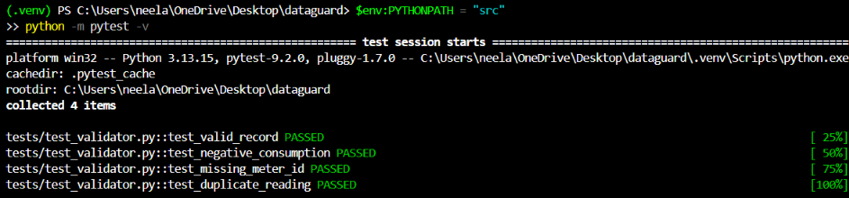
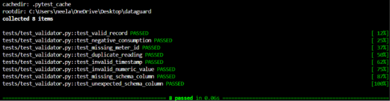
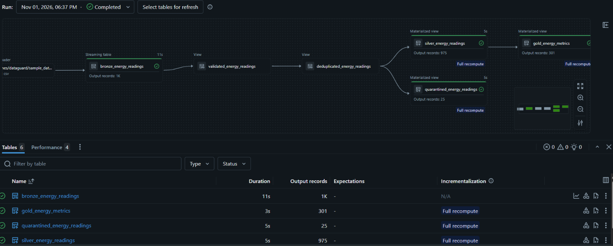
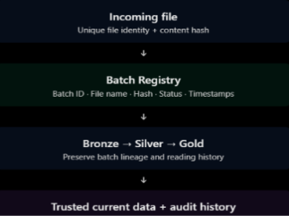
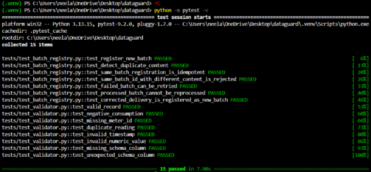

# DataGuard: A Data Reliability and Safe Deployment Platform

## Project Overview

DataGuard is a data reliability and safe deployment project built around synthetic energy-meter data. Its goal is to identify data-quality problems, validate incoming records against predefined rules, and eventually prevent unsafe changes from affecting trusted data.

The project combines Python validation, automated testing, Databricks data engineering, and release-safety checks.

## Problem Statement

A data pipeline can complete successfully while producing incorrect data. Missing values, duplicate readings, invalid measurements, and unexpected schema changes can affect reports and business decisions.

DataGuard aims to detect these problems early, record rejection reasons, support safe reprocessing, and make pipeline behavior easier to monitor.

## Tech Stack

- **Python:** Data generation and validation logic.
- **JSON:** Data contract configuration.
- **CSV:** Synthetic energy-meter test data.
- **pytest:** Automated testing.
- **Git and GitHub:** Version control and project collaboration.
- **SQLite:** Local persistent batch registry.
- **Databricks, PySpark, and Delta Lake:** Cloud data processing and storage.
- **Lakeflow Spark Declarative Pipelines:** Declarative ETL implementation.
- **Unity Catalog:** Data governance and Volume-based file storage.
- **Declarative Automation Bundles:** Databricks resource deployment.

## Project Structure

```text
dataguard/
├── config/
│   └── data_contract.json
├── data/
│   ├── generate_sample_data.py
│   ├── create_correction_batch.py
│   └── sample/
│       └── energy_readings.csv
├── incoming/
│   ├── BATCH_001.csv
│   ├── BATCH_002.csv
│   ├── BATCH_003.csv
│   └── BATCH_004.csv
├── batch_manifests/
│   ├── BATCH_001.json
│   ├── BATCH_002.json
│   ├── BATCH_003.json
│   └── BATCH_004.json
├── src/
│   └── dataguard/
│       ├── __init__.py
│       ├── validator.py
│       └── batch_registry.py
├── tests/
│   ├── __init__.py
│   ├── test_validator.py
│   └── test_batch_registry.py
├── dataguard_pipeline/
│   ├── databricks.yml
│   ├── pyproject.toml
│   ├── resources/
│   └── src/
│       └── dataguard_pipeline_etl/
│           ├── explorations/
│           └── transformations/
│               ├── bronze.py
│               ├── silver.py
│               └── gold.py
├── docs/
├── .gitignore
├── README.md
└── requirements.txt
```

## Implementation Roadmap

The project will continue through these planned phases:

1. Complete project setup.
2. Define data contracts and generate realistic test data.
3. Complete the local validation engine and verify it with pytest.
4. Build the Bronze, Silver, and Gold Medallion pipeline in Databricks.
5. Implement idempotent processing, duplicate-delivery detection, and correction handling.
6. Record operational metrics, failures, and pipeline runs.
7. Add automated testing and release-safety checks.
8. Configure GitHub Actions and supported Databricks deployment resources.
9. Build Pipeline Health, Data Quality, and Release Safety dashboard views.
10. Perform end-to-end verification and complete the documentation.

## 1. Data Contract

I defined an initial JSON data contract in `config/data_contract.json`. It specifies the expected columns and data types, required values, non-negative energy consumption, and a composite business key consisting of building ID, meter ID, and reading timestamp.

This contract provides a common reference for validating incoming records.

## 2. Synthetic Test Data

I created `data/generate_sample_data.py` to generate 1,000 synthetic energy-meter records reproducibly using a fixed random seed.

The dataset includes multiple buildings, meters, timestamps, ingestion batches, and varied energy-consumption values. I also introduced missing values, negative measurements, invalid numeric values, and duplicate readings to test validation behavior.

The generated dataset is stored in `data/sample/energy_readings.csv`.

## 3. Local Validation Engine

I implemented `src/dataguard/validator.py` to load the data contract and validate the generated CSV.

The current implementation checks:

- Missing and unexpected columns.
- Missing required values.
- Invalid timestamps and numeric values.
- Negative energy consumption.
- Duplicate readings based on the configured composite key.

The validator separates accepted and rejected records and provides rejection reasons for investigation. Schema compatibility errors are reported separately.

### Initial Validation Results

The first execution processed the generated dataset and reported:

| Metric                   | Result |
| ------------------------ | -----: |
| Total records            |  1,000 |
| Accepted records         |    975 |
| Rejected records         |     25 |
| CSV header schema errors |      0 |

These results represent the initial local validation run. They will be verified further through automated tests and expanded implementation scenarios.

## Local Development Setup

I use a Python virtual environment to isolate project dependencies.

Create and activate the environment:

```powershell
py -m venv .venv
Set-ExecutionPolicy -Scope Process -ExecutionPolicy Bypass
.\.venv\Scripts\Activate.ps1
```

Install the recorded dependency:

```powershell
python -m pip install -r requirements.txt
```

Generate the sample dataset:

```powershell
python data/generate_sample_data.py
```

Run the validation engine:

```powershell
$env:PYTHONPATH = "src"
python -m dataguard.validator
```

## Automated Testing

I installed pytest and created initial tests in `tests/test_validator.py` for valid records, negative consumption, missing meter IDs, and duplicate readings.

I executed the initial pytest test suite, and all four tests passed successfully. The tests cover valid records, negative consumption, missing meter IDs, and duplicate readings.


I expanded my pytest suite to cover eight validation scenarios, including valid records, negative consumption, missing values, duplicate readings, invalid timestamps, invalid numeric values, missing schema columns, and unexpected schema columns. These tests verify both individual record validation and incoming dataset schema compatibility.



Eight automated tests passed.
A deliberate validation failure was detected.
All eight tests passed after restoring the rule.

This demonstrated how automated regression testing can catch unintended code changes before they affect trusted data.

## 4. Lakeflow Medallion Pipeline

Implemented and deployed the DataGuard Medallion pipeline using Databricks Lakeflow Spark Declarative Pipelines and Declarative Automation Bundles.

### Pipeline implementation

- **Bronze:** Ingested raw energy-meter CSV records from a Unity Catalog Volume.
- **Silver:** Validated records, converted data types, detected duplicate business keys, and separated accepted and rejected records.
- **Quarantine:** Preserved rejected records with their validation reasons.
- **Gold:** Generated daily building-level energy consumption metrics.

### Verified execution results

| Dataset                 | Records |
| ----------------------- | ------: |
| Bronze                  |   1,000 |
| Silver                  |     975 |
| Quarantine              |      25 |
| Gold aggregation groups |     301 |

The local Python validator and Databricks pipeline produced matching accepted and rejected record counts.

Silver validation confirmed 975 unique business keys, with no missing required identifiers, timestamps, or negative consumption values.

Quarantine inspection identified five records in each of the following categories: duplicate readings, missing meter IDs, missing timestamps, negative consumption, and invalid consumption values.

Gold validation confirmed 301 aggregation groups covering all 975 accepted readings, with the checked quality conditions passing.

**Status:** Initial end-to-end pipeline execution and data-quality verification completed. Idempotent reprocessing, recovery, and late-arriving correction scenarios remain to be implemented and tested.

### Establish a reliable batch identity

We should distinguish two concepts:

source_batch_id : Identifies the source batch recorded in an individual reading
ingestion_batch_id : Identifies the actual file/batch delivered to DataGuard

Incoming file : energy_readings_20261030_001.csv
DataGuard identifies the delivery : ingestion_batch_id = 20261030_001


First delivery → Process
Same delivery again → Recognize it
New delivery → Process as a new batch
Corrected delivery → Process as a new version and apply the correction policy

### Build the Batch Registry

Now we'll create a local batch registry to establish and test our idempotency rules before implementing the equivalent Delta table in Databricks.
We'll use SQLite locally because it provides persistent storage and transactional updates without requiring another package.

### Automate our idempotency tests

Now we'll convert the successful experiment into repeatable pytest tests. This ensures that future code changes cannot silently break batch registration.

### Run the complete regression suite

We should make sure our new registry hasn't broken the original validator tests.


- 8 original validator tests passed.
- 7 new batch registry tests passed.

### Batch Registry Testing

I extended the project with a local SQLite-based batch registry to track incoming deliveries and prevent duplicate processing.

The registry uses SHA-256 content hashes to identify identical files, even when they arrive with different filenames.

I added seven automated tests covering new batch registration, duplicate content detection, repeated registration, batch ID conflicts, failed-batch retries, invalid status transitions, and corrected deliveries.

The complete regression suite now contains 15 passing tests:

- 8 validator tests.
- 7 batch registry tests.

This verifies that the batch registry works without breaking the original validation engine.

## 5. Idempotency & Recovery

This phase focuses on making DataGuard reliable when the same delivery arrives again, a pipeline needs to be reprocessed, or a source system submits corrected data.

### Establishing Reliable Batch Identity

I distinguish two identifiers:

- `source_batch_id`: Identifies the source batch recorded in an individual reading.
- `ingestion_batch_id`: Identifies the actual file or delivery received by DataGuard.

I also use SHA-256 `content_hash` values to identify identical file contents independently of their filenames.

This distinction helps DataGuard identify whether an incoming file is a new delivery, a repeated delivery, or a corrected version of an existing reading.

### Local SQLite Batch Registry

I implemented `src/dataguard/batch_registry.py` using SQLite.

The registry supports:

- Registering new deliveries.
- Detecting identical content using SHA-256 hashes.
- Recognizing already registered batches.
- Rejecting reuse of a batch ID with different content.
- Tracking processing states such as RECEIVED, PROCESSING, PROCESSED, FAILED, and DUPLICATE.
- Retrying failed batches while preventing invalid state transitions.

I also added seven automated tests to verify the registry behavior.

### Databricks Phase 5 Bronze Ingestion

I extended the existing Lakeflow pipeline with a separate Phase 5 Bronze streaming table:

`dataguard.bronze.bronze_energy_readings_phase5`

I created separate directories in the Unity Catalog Volume for incoming CSV files and their JSON manifests.

```text
/Volumes/dataguard/sample_data/dataguard_files/phase5_incoming/

/Volumes/dataguard/sample_data/dataguard_files/phase5_manifests/
```

I used Auto Loader to incrementally ingest incoming CSV files and enriched the Bronze records with manifest metadata, including:

- `ingestion_batch_id`
- `content_hash`
- `record_count`
- `batch_created_at`
- `manifest_match_status`
- `source_file`
- `ingested_at`

I verified that BATCH_001 and BATCH_003 were successfully matched with their manifests and had identical SHA-256 content hashes.

### Databricks Batch Registry

I implemented a declarative materialized view:

`dataguard.bronze.batch_registry_phase5`

It identifies deliveries with identical content hashes, selects a canonical delivery, and classifies subsequent identical deliveries as duplicates.

The verified results are:

| Batch     | Records | Status    | Duplicate of |
| --------- | ------: | --------- | ------------ |
| BATCH_001 |   1,000 | ACCEPTED  | NULL         |
| BATCH_003 |   1,000 | DUPLICATE | BATCH_001    |

I initially encountered inconsistent timestamp formats between the manifests. I corrected the timestamp normalization to UTC so that the intended original delivery was selected as canonical.

**Implementation distinction:** The Databricks registry is currently a derived materialized view. It does not yet implement the persistent processing-state transitions available in the local SQLite registry.

### Corrected Delivery Experiment

I created `data/create_correction_batch.py` to generate a new delivery containing a corrected version of an existing reading without modifying the original batch.

The correction scenario uses the following reading:

| Field                 | Value               |
| --------------------- | ------------------- |
| Building ID           | B011                |
| Meter ID              | M106                |
| Reading timestamp     | 2026-10-04 06:15:00 |
| Original consumption  | 138.73              |
| Corrected consumption | 124.86              |

I generated BATCH_004 with one corrected record and its corresponding JSON manifest.

After uploading both files and rerunning the pipeline, I verified that:

- BATCH_004 was recognized as a new delivery.
- Its content hash was different from the original delivery.
- Its manifest was successfully matched.
- Its corrected reading was ingested into the Phase 5 Bronze table.
- The registry classified it as ACCEPTED rather than DUPLICATE.

The Phase 5 Bronze table processed one new record during this incremental pipeline run.

### Silver Reading History and Current-State Management

I extended the Phase 5 pipeline with separate Silver views for reading validation, within-delivery deduplication, historical version tracking, and current-state reporting.

The implementation introduces two materialized views:

- `dataguard.silver.reading_history_phase5`
- `dataguard.silver.current_energy_readings_phase5`

The historical table preserves accepted versions of a reading, while the current-state table exposes only the latest accepted version.

I used `ingestion_batch_id` in the deduplication key so that duplicate readings within the same delivery are detected without incorrectly removing corrections arriving in a different delivery.

#### Verified Correction Scenario

For the B011 / M106 reading, I verified:

| Batch     | Energy consumption | Version | Is current |
| --------- | -----------------: | ------: | ---------- |
| BATCH_001 |             138.73 |       1 | false      |
| BATCH_004 |             124.86 |       2 | true       |

The historical table contains both versions, while the current-state table contains only the corrected value of 124.86.

#### Verified Pipeline Results

| Dataset                  | Records |
| ------------------------ | ------: |
| Phase 5 batch registry   |       3 |
| Phase 5 reading history  |     976 |
| Phase 5 current readings |     975 |

BATCH_003 was excluded from reading history because it contained identical file content to BATCH_001.

The original Phase 4 datasets remained unchanged:

- Bronze: 1,000 records
- Silver: 975 records
- Quarantine: 25 records
- Gold: 301 aggregation groups

### Pipeline Rerun and Failure-Recovery Testing

I tested the Phase 5 pipeline by rerunning it without uploading additional files. The existing delivery results remained unchanged, demonstrating idempotent behavior for a normal pipeline rerun using its existing checkpoint.

I also verified the local SQLite registry's failure-recovery behavior.

The registry supports retrying failed batches while preventing already processed batches from being processed again through invalid state transitions.

#### Automated Test Results

I now have 15 passing automated tests:

| Test suite     | Tests passed |
| -------------- | -----------: |
| Data validator |            8 |
| Batch registry |            7 |
| Total          |           15 |

The tests cover validation rules, duplicate content detection, repeated registration, batch ID conflicts, failed-batch retries, invalid status transitions, and corrected delivery registration.

I used `python -m pytest` to run the tests because Windows Application Control blocked direct execution of `pytest.exe`.
