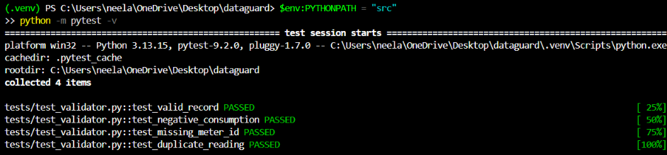

# DataGuard: A Data Reliability and Safe Deployment Platform

## 1. Project Overview

DataGuard is a data reliability and safe deployment project built around synthetic energy-meter data. Its goal is to identify data-quality problems, validate incoming records against predefined rules, and eventually prevent unsafe changes from affecting trusted data.

The project combines Python validation, automated testing, Databricks data engineering, and release-safety checks.

## 2. Problem Statement

A data pipeline can complete successfully while producing incorrect data. Missing values, duplicate readings, invalid measurements, and unexpected schema changes can affect reports and business decisions.

DataGuard aims to detect these problems early, record rejection reasons, support safe reprocessing, and make pipeline behavior easier to monitor.

## 3. Tech Stack

- **Python:** Data generation and validation logic.
- **JSON:** Data contract configuration.
- **CSV:** Synthetic energy-meter test data.
- **pytest:** Automated testing.
- **Git and GitHub:** Version control and project collaboration.
- **Databricks, PySpark, and Delta Lake:** Planned data processing and storage.

## 4. Project Structure

```text
dataguard/
├── config/
│   └── data_contract.json
├── data/
│   ├── generate_sample_data.py
│   └── sample/
│       └── energy_readings.csv
├── docs/
├── resources/
├── src/
│   └── dataguard/
│       ├── __init__.py
│       └── validator.py
├── tests/
│   ├── __init__.py
│   └── test_validator.py
├── .gitignore
├── README.md
└── requirements.txt
```

## 5. Data Contract

I defined an initial JSON data contract in `config/data_contract.json`. It specifies the expected columns and data types, required values, non-negative energy consumption, and a composite business key consisting of building ID, meter ID, and reading timestamp.

This contract provides a common reference for validating incoming records.

## 6. Synthetic Test Data

I created `data/generate_sample_data.py` to generate 1,000 synthetic energy-meter records reproducibly using a fixed random seed.

The dataset includes multiple buildings, meters, timestamps, ingestion batches, and varied energy-consumption values. I also introduced missing values, negative measurements, invalid numeric values, and duplicate readings to test validation behavior.

The generated dataset is stored in `data/sample/energy_readings.csv`.

## 7. Local Validation Engine

I implemented `src/dataguard/validator.py` to load the data contract and validate the generated CSV.

The current implementation checks:

- Missing and unexpected columns.
- Missing required values.
- Invalid timestamps and numeric values.
- Negative energy consumption.
- Duplicate readings based on the configured composite key.

The validator separates accepted and rejected records and provides rejection reasons for investigation. Schema compatibility errors are reported separately.

### Initial Validation Results

The first execution processed the generated dataset and reported:

| Metric                   | Result |
| ------------------------ | -----: |
| Total records            |  1,000 |
| Accepted records         |    975 |
| Rejected records         |     25 |
| CSV header schema errors |      0 |

These results represent the initial local validation run. They will be verified further through automated tests and expanded implementation scenarios.

## 8. Local Development Setup

I use a Python virtual environment to isolate project dependencies.

Create and activate the environment:

```powershell
py -m venv .venv
Set-ExecutionPolicy -Scope Process -ExecutionPolicy Bypass
.\.venv\Scripts\Activate.ps1
```

Install the recorded dependency:

```powershell
python -m pip install -r requirements.txt
```

Generate the sample dataset:

```powershell
python data/generate_sample_data.py
```

Run the validation engine:

```powershell
$env:PYTHONPATH = "src"
python -m dataguard.validator
```

## 9. Automated Testing

I installed pytest and created initial tests in `tests/test_validator.py` for valid records, negative consumption, missing meter IDs, and duplicate readings.

The tests have been written but have not yet been executed and verified. Automated test execution and release checks remain part of the next implementation steps.

## 10. Implementation Roadmap

The project will continue through these planned phases:

1. Complete project setup.
2. Define data contracts and generate realistic test data.
3. Complete the local validation engine and verify it with pytest.
4. Build the Bronze, Silver, and Gold Medallion pipeline in Databricks.
5. Implement idempotent processing and recovery.
6. Record operational metrics, failures, and pipeline runs.
7. Add automated testing and release-safety checks.
8. Configure GitHub Actions and supported Databricks deployment resources.
9. Build Pipeline Health, Data Quality, and Release Safety dashboard views.
10. Perform end-to-end verification and complete the documentation.

## 11. Current Status

The repository setup, initial data contract, synthetic dataset generator, and first version of the local validation engine are in place. Initial validation results have been observed, and the first pytest tests have been written.

I executed the initial pytest test suite, and all four tests passed successfully. The tests cover valid records, negative consumption, missing meter IDs, and duplicate readings.
